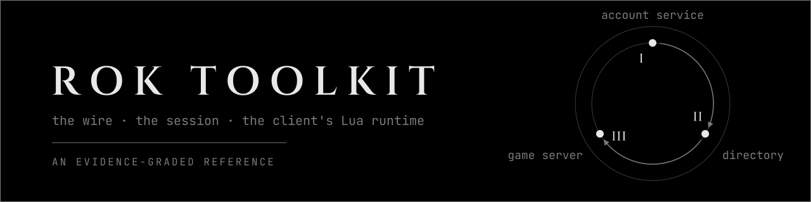
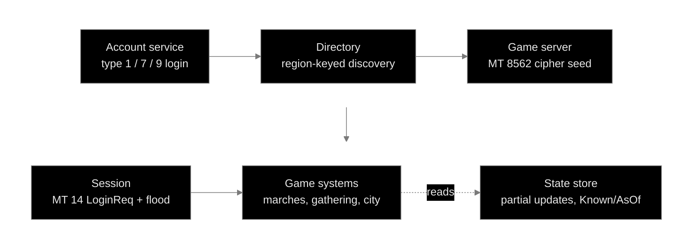

<div align="center">

<h1></h1>

### An evidence-graded reference to the *RoK* client protocol: the wire, the session, and the client's Lua runtime.

[](#how-to-read-the-evidence)
[](#status)

[Login and session](docs/headless/01-login.md) · [Wire protocol](docs/headless/02-wire-protocol.md) · [Game systems](docs/headless/game-systems/README.md) · [Lua runtime](docs/lua-runtime/README.md) · [Documentation map](docs/README.md) · [FAQ](#faq)

</div>

---

> [!NOTE]
> Start with **[Login and Initial Game State](docs/headless/01-login.md)**: account-service authentication, server discovery, the cipher seed, request bodies, field groups, post-acknowledgement timings.

RoK Toolkit is a technical reference for the platform behind *RoK*: how the account service issues credentials, how the directory names a game server, what rides the socket after the cipher seed, and how the client's own runtime represents that state. Field for field, labeled MEASURED, INFERRED, or UNKNOWN. The reference covers the wire protocol as observed from outside the client and the Lua runtime as observed from within it.

Written for engineering review: every claim carries an evidence label grounded in captures or working code, and unverified behavior is identified explicitly.

## What is documented

| Layer | What the docs give you | Guide |
| --- | --- | :---: |
| **Login methods** | Four login methods (password, email code, returning token, Google), request fields, refusal codes and meanings | [Guide](docs/headless/01-login.md#login-methods) |
| **Regional builds** | Three builds (International, Gamota, Korea): enforced `app_id`s, environment IDs, directory keys | [Guide](docs/headless/01-login.md#regional-builds) |
| **Session and state** | Measured post-ack timings, initial partial updates, known and stale state | [Guide](docs/headless/01-login.md#step-5-after-the-ack) |
| **Wire and cipher** | Framing, MT 8562 seed handshake, keystream and verification vector, envelopes, compression | [Guide](docs/headless/02-wire-protocol.md) · [Registry](docs/headless/04-message-registry.md) |
| **Identity and fingerprint** | The per-account DeviceProfile, field mappings (MT 14, SDK HTTP, TLS), identity evidence limits | [Guide](docs/headless/03-identity.md) |
| **Game systems** | Gathering, upgrades, training, recalls, and forts: MT pairs and payloads | [Guide](docs/headless/game-systems/README.md) |
| **Lua runtime method** | Frida attachment, Lua table reads, client calls | [Guide](docs/lua-runtime/README.md) |

## The shape of a login



## How to read the evidence

| Label | Meaning |
| --- | --- |
| **MEASURED** | Directly observed on the wire, in a capture, or in running code. |
| **INFERRED** | Evidence-supported, not directly observed. |
| **UNKNOWN** | Not established by available evidence. |

> [!IMPORTANT]
> Placeholders replace identifying field and token values.

<details>
<summary><b>Repository layout</b></summary>

```
docs/
  headless/     The wire protocol: login, cipher, sessions, state, actions
  lua-runtime/   The client's Lua runtime: attach, reads, invocations
```

</details>

## FAQ

**Is there code here?**
No. Documentation, schemas, and captured field tables. The protocols are specified precisely enough to support an independent implementation, and every page states which parts are established and which remain open.

**Which combinations of the three regions and three platforms are measured?**
Evidence is per table: regional rows per region, platform differences per host. Unobserved combinations: UNKNOWN.

**Why do refusal codes get their own table?**
Because they carry meaning beyond failure: 11025 on a valid credential indicates a region mismatch, and codes 27 and 31 are terminal for an identity.

**What is the Lua runtime method?**
The study of the client from the inside: an external process attaches to the running PC client, reads its state, and calls its functions on the client's own session. See the [Lua runtime overview](docs/lua-runtime/README.md).

## Status

> [!TIP]
> The headless method is complete; unknowns are labeled per section.

| Section | State |
| --- | --- |
| Login and initial game state | :white_check_mark: complete |
| Wire protocol and cipher | :white_check_mark: complete |
| Message registry | :white_check_mark: complete |
| Identity and fingerprint | :white_check_mark: complete |
| Game system actions | :white_check_mark: complete |
| Lua runtime method | :white_check_mark: complete |
