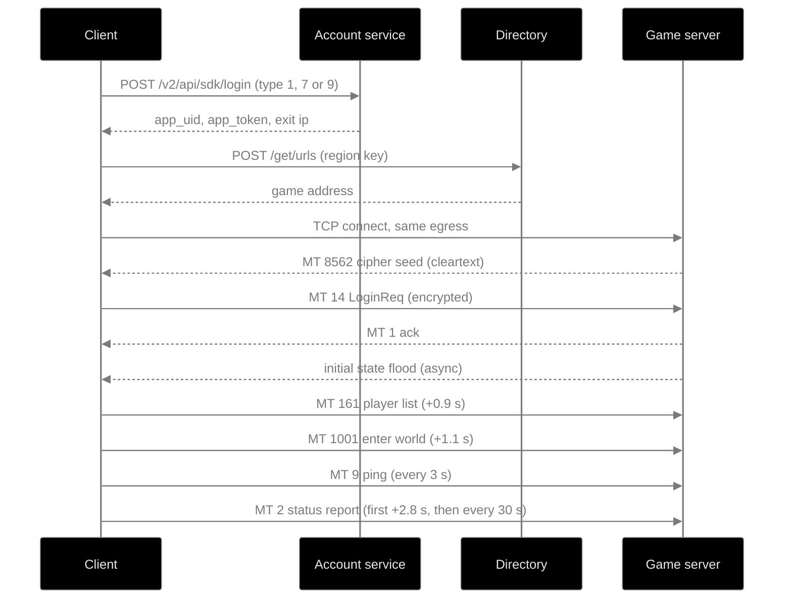
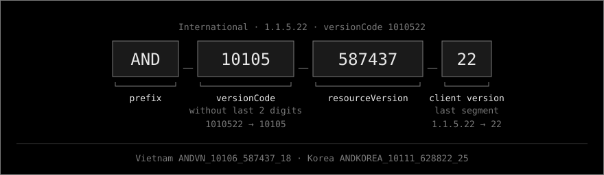

<sub>[RoK Toolkit](../../README.md) › [Docs](../README.md) › [Headless](README.md) › Login and Initial Game State</sub>


# Login and Initial Game State

Three services handle login: the account service authenticates the account over HTTPS and issues an app token, the directory names a game server, and that server hosts the game socket. Game state starts arriving only after the world is entered, and the server pushes while the client is still finishing its own login steps.

**On this page:** [Before you start](#before-you-start) · [Login methods](#login-methods) · [Regional builds](#regional-builds) · [Build identity](#build-identity) · [Platform hosts](#platform-hosts) · [Account login](#step-1-account-login) · [Server discovery](#step-2-server-discovery) · [Cipher seed](#step-3-connect-and-seed-the-cipher) · [LoginReq](#step-4-loginreq) · [After the ack](#step-5-after-the-ack) · [Failure modes](#failure-modes) · [After login](#what-you-have-after-login)



## Before you start

Four choices decide whether a login can succeed, and each owns its own section: the [login method](#login-methods) the account has a credential for, the [regional build](#regional-builds) the account belongs to, the [build identity](#build-identity) tuple naming the version presented as, and the [platform host](#platform-hosts) matching the body you send. One rule lives here because it spans all of them:

> [!IMPORTANT]
> The SDK calls and the game socket must leave from the same address. Two addresses for one account is the earliest thing a server can notice.

## Login methods

All methods POST to `/v2/api/sdk/login` and return the same envelope. Only `type` and credential differ.

| Method | `type` | `player_id` | `pass` | Extra fields |
| --- | --- | --- | --- | --- |
| Email and password | `1` | the email | `md5(password + "PassHandler")` | `login_mode: "4"` |
| Email and verification code | `1` | the email | the emailed code | `login_mode: "1"` |
| Returning token | `7` | [...] `app_uid` | [...] `app_token` | none |
| Google | `9` | Google `sub` | Google OIDC ID token | `auth_type: "0"` |

Type 7 is the cheap one a long-running client uses after the first authentication: `data.app_token` from any earlier login is the `pass` of the next.

- Tokens live about 24 hours; rotate before expiry, not after refusal.
- Keep `player_id` a string on every path; the Google subject exceeds int64.

### Google (type 9)

Google login requires four requests:

1. `POST /v2/api/sdk/account/login_url` with `type: 9` and a `local_url` (a localhost listener) returns a Google authorization URL and a `login_id`.
2. Google authorization runs in a browser or webview; its callback goes to [...], not to you.
3. `GET /api/sdk/account/login_redirect_local` answers HTTP 302 to your listener with `user_id` (the Google `sub`) and `access_token` (an OIDC ID token, despite the name).
4. `POST /v2/api/sdk/login` with `type: 9`, `player_id` the sub, `pass` that ID token.

The output is the same `app_uid` / `app_token` pair as every other method, and the immediate follow-up is a plain type 7 with that pair.

## Regional builds

The account service enforces the publisher.

> [!WARNING]
> A login under the wrong region's `app_id` is refused with 11025 `validate_fail`, which reads exactly like a wrong password and names nothing.

| Region | `app_id` | `pack_name` | Directory prefix | `env_id` |
| --- | --- | --- | --- | --- |
| International (Global) | `2104267` | `com.[...]game.roc.gp` | `AND` | `prod95fa8d9f035da4e7f4ca8317b3e5` |
| Vietnam (Gamota) | `6626468` | `com.rok.gp.vn` | `ANDVN` | `prodf98f4160e6f3f744828e5b57dfa1` |
| Korea | `8518744` | `com.[...]games.rok.gpkr` | `ANDKOREA` | `proda7e771a4d3eafb184a6985c573fe` |

Two traps:

- `env_id` existence is checked (a made-up value is refused with code 1001) but a mismatch is not; carry the measured value. The APK's own resource id is a different value from the one onboarding uses
- The Korea prefix is spelled `ANDKOREA`, not `ANDKR`

The [device profile's](03-identity.md#the-device-profile) `app.distribution` carries `global` / `kr`; the Vietnam build is not represented there, and its distinct `app_id` and `pack_name` above are what separate it from Global.

## Build identity

Every request names the build it presents as, and the five version fields must be a coherent set from one real build. Where each comes from:

| Field | Example | Derivation | Surfaces |
| --- | --- | --- | --- |
| `app_version` | `1.1.5.22` | The released build being presented | SDK login, rocdir body, MT 14 f6.10 |
| `version_code` | `1010522` | The build's manifest versionCode | Feeds the rocdir key's middle number (`10105`) |
| `resource_version` | `587437` | The build's live resource version; moves independently via the in-game updater while `app_version` stays put | MT 14 f12, rocdir key |
| `version_token` | `1f5cb5b2...` | The bundled `ConfigFile.VersionToken` literal of that build | MT 14 f20 |
| `sdk_version` | `7.11.0.1` | The SDK shipped in that build | SDK login body |

**MEASURED**

The game force-updates before login, so stale version strings never reach the gate from real clients. Any login claiming a version the server has retired is not a real client. Mixing values across builds (one region's `app_id` with another's token, a new `app_version` with an old `resource_version`) is a mismatch the server can check.

## Platform hosts

| Platform | Host | Body |
| --- | --- | --- |
| Android | `app.[...]game.com` | Form-encoded; no `sdk_signature`. |
| PC | `app-pc.[...]game.com` | Adds `env_id`, `sdk_timestamp`, `sdk_signature` (64 hex), and `hardware_info` / `network_info` / `sensor_info` / `system_info` telemetry. |
| iOS | `app.[...]game.com` | Type 7 with `idfa`, `install_id`, `sdk_session_id` (uppercase UUID + epoch ms), `att_status`, `is_jailbreak`, six locale fields, and an iOS User-Agent. |

Same path, different request bodies.

## Step 1: Account login

Android returning-token request. Other credential fields: [Login methods](#login-methods).

```text
POST /v2/api/sdk/login

{
  "type": "7",
  "player_id": "<app-uid>",
  "pass": "<app-token>",
  "app_id": "<regional-app-id>",
  "game_id": "10043",
  "sdk_version": "<sdk-version>",
  "os_type": "android",
  "os_version": "<os-version>",
  "device_model": "<device-model>",
  "device_brand": "<device-brand>",
  "device_name": "<device-name>",
  "device_abi": "arm64-v8a",
  "lang": "<lang-code>",
  "pack_name": "<package-name>",
  "app_version": "<client-version>",
  "android_id": "<android-id>",
  "google_aid": "<google-aid>",
  "channel_id": "<channel>"
}
```

Response: session token and observed source address.

```text
{"result":{"code":0},"data":{
  "app_uid": "<user-id>",
  "app_token": "<app-token>",
  "app_token_expire_at": <unix-seconds>,
  "ip": "<exit-ip>",
  "region": "<region>",
  "bindings": [<bound-types>],
  "third_party_info": {"open_id": "<provider-sub>", "email": "", "name": ""}
}}
```

Keep the returned `ip`; the game login reuses it in Step 4. The account session also expects a periodic `POST /v2/api/sdk/account/heart_beat`, answered `{ "result": { "code": 0 } }` on success.

## Step 2: Server discovery

The directory POST identifies the build.

```text
POST https://rocdir.[...]game.com/get/urls?key=<directory-key>
     &udid=<udid>&app_uid=<app-uid>&app_token=<app-token>&server_id=<kingdom>

headers: AppUid, SdkAppToken, ClientKey (the same key), udid

{
  "AppVersion": "<client-version>",
  "AndroidID": "<android-id>",
  "AppId": "<regional-app-id>",
  "DeviceModel": "<device-model>",
  "GoogleAid": "<google-aid>",
  "LgChannel": "and",
  "AppUid": "<app-uid>"
}
```

Derived `key`:

```text
<prefix>_<versionCode-without-last-2-digits>_<resourceVersion>_<client-version-last-segment>

AND_10105_587437_22        International 1.1.5.22 (versionCode 1010522)
ANDVN_10106_587437_18      Vietnam 1.1.6.18 (versionCode 1010618)
ANDKOREA_10111_628822_25   Korea 1.1.11.25 (versionCode 1011125)
```

<p align="center"></p>

The response's first `Servers[0].Addr` is the game server for this session. When the directory returns no server list, the build's own default game address is the fallback.

`GET /get/roles?app_uid&app_token&app_id&sdk_type=1&lg_channel=and&udid&lang=en&region_id=1` returns the account's governor roster: per region, `Players[]` with `PlayerId`, `PlayerName`, `ServerId`, `Power`, `TownCenterLevel`. Some fields arrive as numbers or quoted strings, so the parser accepts both.

`POST /login/role?...&server_id&player_id&os_type=android&platform=android` registers the chosen governor for this session: empty body, headers `Accept: */*`, `User-Agent: limpc-<sdk_version>`, `Im-Session-Id` (a fresh ≥30-uppercase-hex-digit id), `Content-Length: 0`. Its answer carries the ban state: `message: LC_COMMON_BAN_ADDON_[...]`, or `errorType 97` with a nonzero `banUntil`, is a ban (epoch seconds or milliseconds); anything else that is not a clean success is classified as an errored check.

The SDK sends `POST /v2/api/sdk/account/user` right after a token login. That call and the `heart_beat` above both take the form `app_id, app_uid, app_token, os_type, pack_name`. The SDK login answer is tolerant in two ways the parser must accept:

- The payload sits at the top level or under `result.data`
- `app_uid` may be numeric or a quoted string

> [!IMPORTANT]
> The type-7 `app_token` rotates on every success, so persist the new one each login.

When the SDK answers `need_captcha` with a `captcha_url`, the retry carries a `captcha_id`: the solver's proof is committed at `captcha-api-global.[...]game.com` (`GET /api/v1/captcha/gee_captcha_id?client_id=666_heim_global_sdk&secret_id&lot_number&captcha_output&act_id&pass_token&gen_time&timestamp&signature`). The returned `data.captcha_id` is replayed into the login form (up to 5 rounds).

## Step 3: Connect and seed the cipher

Dial the game address through the same route the account login used.

The first frame arrives in cleartext: message type 8562, the cipher seed. It carries two nonces. Every later frame in both directions is encrypted with ciphers seeded from those nonces:

```text
c2s state = low 32 bits of (nonce2 / 3 + 10086)
s2c state = low 32 bits of ((nonce1 >> 1) + 1024)
```

The keystream algorithm and a verification vector are documented in [Wire and cipher](02-wire-protocol.md#the-keystream).

> [!WARNING]
> The reader that consumed the seed frame must remain the session's reader. No byte may be dropped between the two: dropping one shifts the stream position and invalidates all later decryption.

## Step 4: LoginReq

First encrypted request: MT 14, with five field groups.

| Group | Fields | Notes |
| --- | --- | --- |
| Account | `acc.app_uid`, `acc.app_token`, `acc.app_id`, `acc.lg_channel`, `acc.sdk_type` | From Step 1. `lg_channel` is `and`, `sdk_type` is 1. |
| Identity | `udid`, `device.machine_guid`; `device.android_id`, `device.google_aid` | Stable per account, same values as Step 1. The Android IDs reach MT 14 only in the legacy layout's SDK-attach block; the captured phone client sends that block empty and carries them in the SDK login body instead. |
| Device | `device.os_type`, `device.os_version`, `device.model`, `device.vendor`, `device.locale`, `device.gpu`, `device.cpu_model`, `device.height`, `device.width` | The phone this account claims to be. |
| Build | `game_version`, `resource_version`, `version_token`, `app_version` | Must match a build the server accepts. `version_token` differs per build and version. |
| Network | `ip_from_client`, `device.ip`, `device.ip_port`, `server_addr` | The exit address from Step 1 and the address dialed in Step 3. |

The client also sends fixed scalars a real client always sends: `type: 1`, `login_type: -1`, `bind_acc: "7"`, `civilization_no_default: true`, `device_level: 2`. The Korean build adds `region: "KOREA"`.

### The reconstructable field map

**MEASURED** · captures

The two captured Android layouts (the phone client and a legacy approximation) differ in structure as well as values.

| Slot | Phone (captured client) | Legacy (approximation) |
| --- | --- | --- |
| `6.5 ChannelID` | The build's device channel | `and` |
| `6.18` CPU | The ABI (`arm64-v8a`) | The SoC brand |
| `6.22`/`6.23` | `ip:port` / **the udid** | same |
| `6.24` CPU model | The CPU model, `arm64-v8a` fallback | `arm64-v8a` |
| `6.19`/`6.20` dims (phone; legacy uses `6.25`/`6.26`) | Long edge first / short edge | Height / `MachineGuid` = the udid |
| `6.27` | Absent | `SubOsType` = `android` |
| Advertised address (13, 6.7) | The exit IP the SDK login reported, ephemeral port 32768-60999 | A frozen node address, port 49152-65535 |
| SDK attach | An empty block | `Channel`/`ADSource` filled with the AndroidID/GoogleAid |

The account block (`acc`) is era-invariant: `app_uid` and `app_token` as strings, the regional `app_id`, `lg_channel "and"`, `sdk_type 1`. Fields with explicitly empty values are sent. On Android, `IDFA` is always present and empty.

The reply is message type 1. Success is an ack.

> [!IMPORTANT]
> A request that times out is an unanswered request, never an assumed success.

## Step 5: After the ack

The server starts pushing initial state immediately after the ack, while the client finishes its own login steps. Capture offsets:

| Offset | Message | Purpose |
| --- | --- | --- |
| +0.9 s | MT 161 `AccGetPlayerListReq` | Asks for the account's governors. The reply lists them (registry: MT 162); picking one is what makes this session that governor's session. |
| +1.1 s | MT 1001 `EnterWorldMapReq` | Enters the world. |
| +2.8 s, then every 30 s | MT 2 `ClientStatusReport` | Status tick. |
| Every 3 s | MT 9 | Keepalive ping. |

Initial state arrives as separate partial updates: city coordinates, home troops, commanders, active marches, map sightings, and event state. Continue reading after the burst and query remaining gaps. Sightings prove neither full coverage nor current presence.

## Failure modes

| Where | Signal | Meaning | Action |
| --- | --- | --- | --- |
| Account login | result code 11025 | Credential refused | One retry with the password if a token was stored, then stop. A repeatedly refused login is stale. |
| Account login | 11025 on a known-good credential | Wrong region's `app_id` | The account belongs to a different publisher build. Re-send under the right region. |
| Account login | result code 1001 | `env_id` not valid | The environment id does not exist. Use the measured one for the build. |
| Account login | `need_captcha` | Challenge required | Solve the challenge and resend with `captcha_id`. |
| Directory | empty or missing build | Wrong directory key | The prefix or version tuple names a build that does not exist. |
| Role login | `LC_COMMON_BAN_ADDON_[...]` or `errorType 97` + `banUntil` | Governor banned | The `banUntil` epoch is the expiry; do not proceed to the game socket. An errored check is unknown, never clean. |
| Game login | MT 1 code 27 or 31 | Device or login refused | Terminal for this identity. Do not retry with the same device fields. |
| Game login | LoginReq unanswered | Timeout or silent drop | Treat as failure. There is no success without the ack. |

## What you have after login

An encrypted connection, a governor chosen from the MT 161 ack, a live stream of state updates, and two keepalive loops: the MT 9 ping every 3 s and the MT 2 status report every 30 s. Whether dropping one ends the session was not tested (**UNKNOWN**); both loops together kept every measured session alive.

---

<div align="center">

[↑ The Headless Method](README.md) &nbsp;·&nbsp; [Wire Protocol and Cipher →](02-wire-protocol.md)

</div>
