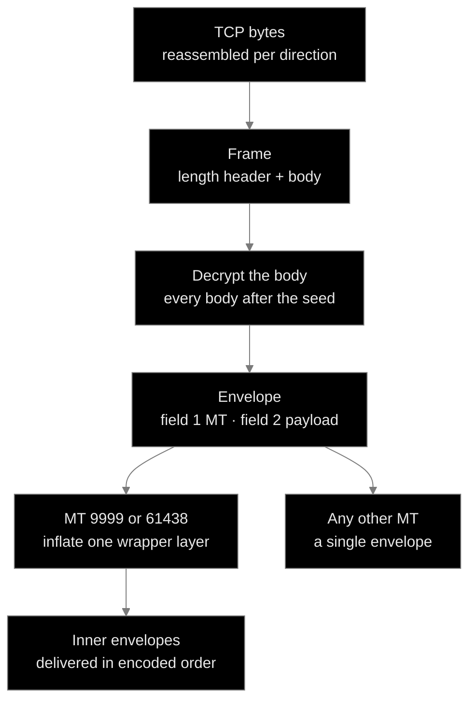
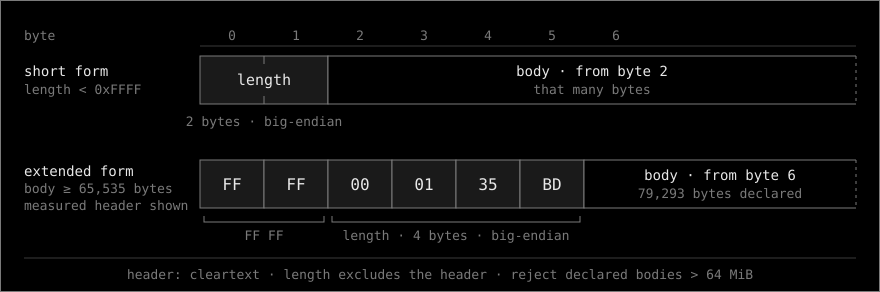
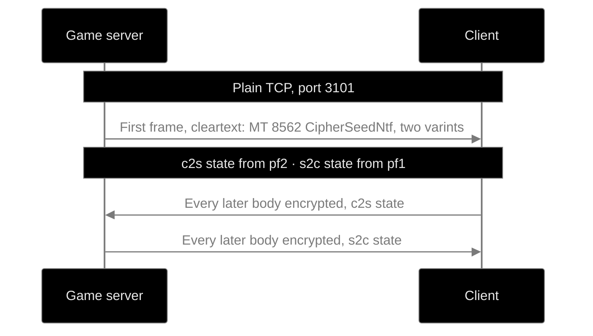
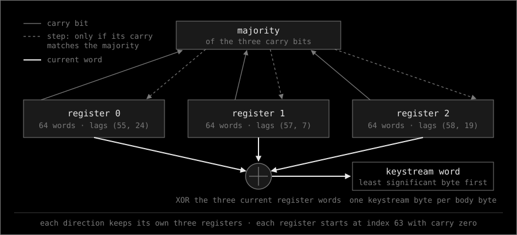
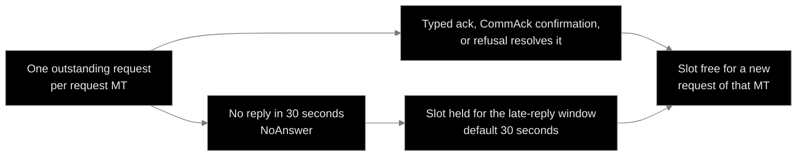

<sub>[RoK Toolkit](../../README.md) › [Docs](../README.md) › [Headless](README.md) › Wire Protocol and Cipher</sub>


# Wire Protocol and Cipher

The game socket is plain TCP on port 3101. After the cipher seed, every body in both directions is encrypted.

**On this page:** [Frame layout](#frame-layout) · [Seed handshake](#the-seed-handshake) · [Keystream](#the-keystream) · [Envelope](#the-envelope) · [Encoding rules](#encoding-rules-the-payloads-rely-on) · [Compression](#compression-wrappers) · [Ordering and acks](#ordering-and-acknowledgements) · [Lifecycle](#connection-lifecycle)



## Frame layout

**MEASURED**

Cleartext length header plus body. Only the seed body is cleartext.

<p align="center"></p>

| Header bytes | Body length | Body starts at |
| --- | --- | --- |
| Two-byte big-endian value less than `0xFFFF` | That value | Byte 2 |
| `FF FF` followed by a four-byte big-endian value | The four-byte value | Byte 6 |

- Length excludes the header.
- Extended form: body ≥65,535 bytes.
- Reject declared bodies >64 MiB.
- The measured header `ff ff 00 01 35 bd` declares a 79,293-byte body.

No direction marker, sequence number, IV, checksum, or authentication tag in the header or trailer. Direction follows socket endpoints. MT `8003` (`TickNtf`) carries a payload tick, not a transport sequence number.

For a capture of a session, reassemble TCP bytes separately per direction. Use TCP sequence numbers to order bytes and deduplicate retransmissions before reading frames. Segments need not start or end on frame boundaries.

## The seed handshake

**MEASURED**

The server's first frame is a cleartext, unwrapped protobuf envelope with MT `8562` (`CipherSeedNtf`). A first frame with any other MT, or a seed payload missing either nonce, is a protocol error.

> [!IMPORTANT]
> A decoder without the seed frame and the initial cipher position cannot recover them from a later frame.



The seed payload carries two varints. Initialize the cipher states from them:

```text
c2s state = low 32 bits of (pf2 / 3 + 10086)     # integer division
s2c state = low 32 bits of ((pf1 >> 1) + 1024)
```

The seed frame itself uses neither state. There is no client key contribution and no separate secret exchange at this layer: the server alone seeds both directions, and anyone who reads the first frame can decrypt the session.

> [!WARNING]
> The reader that consumed the seed frame must remain the session's reader. If it buffered bytes past the seed, those bytes belong to the next frame; dropping them shifts the stream position and invalidates all later decryption.

## The keystream

**MEASURED** · source inspection + wire verification

Each direction keeps three 64-word lagged Fibonacci registers, initialized from that direction's seed value. Each register starts at index 63 with carry zero.

<p align="center"></p>

Per keystream word:

1. Compute the majority of the three carry bits.
2. Only registers whose carry matches that majority step. A step advances the index modulo 64, adds the two lagged words, stores the low 32 bits, and sets the carry to the high bit of the sum.
3. The lag pairs are `(55, 24)`, `(57, 7)`, and `(58, 19)` for registers 0, 1, and 2 respectively.
4. XOR the three current register words to produce the keystream word.

Consume each keystream word least significant byte first, XORing one keystream byte with each body byte. Encryption and decryption are the same operation.

> [!IMPORTANT]
> Keep unused keystream bytes for the next body. Never consume keystream for length headers. Never reset state between frames.

One cipher per direction per connection. A missing, repeated, or reordered body byte shifts that direction's stream position and invalidates all later decryption. Writes are serialized through one writer so frames and cipher bytes cannot interleave.

### Reference algorithm

```text
state = seed ^ 0x0502_7919
b    = ((state >> 1) & 0x5555_5555) + ((state & 0xd555_5555) << 1)     # wrapping
fb   = ((seed >> 5) ^ (b >> 1) ^ (state >> 3) ^ (seed >> 30) ^ b ^ (b >> 6)) & 1
c    = ~(((state << 4) & 0xf0f0_f0f0) | ((state >> 4) & 0x0f0f_0f0f))
initial[0] = feedback(state)
initial[1] = (fb << 31) | (b >> 1)
initial[2] = feedback(c)

# feedback(v) = v >> 1 | parity(v ^ v>>1 ^ v>>2 ^ v>>4 ^ v>>6 ^ v>>31) << 31
# Each register: advance index mod 64, sum its two lagged words, keep low 32
# bits as the word and the high bit as the carry. Lags: (55,24), (57,7), (58,19).

# Register expansion: each register's 64 words are built from its initial
# value v by applying feedback 32 times per word: w[0] is v after 32
# feedback steps, and each w[i] is w[i-1] after 32 more.
# Index starts at 63 with carry zero; the stepping rule above then applies.
```

### Verification vector

**MEASURED**

With seed value `12345`, encrypting sixteen zero bytes yields:

```text
cd f8 d7 c6 ee eb 08 d6 0f 1e 29 3e b4 0b e2 e0
```

Splitting the input bytes across multiple calls produces the same output. Any implementation that matches this vector produces the session keystream.

## The envelope

Decrypted body: protobuf envelope.

| Field | Wire type | Meaning |
| --- | --- | --- |
| 1 | varint | The message type (MT) |
| 2 | length-delimited | The payload bytes; absence means an empty payload |

The first tag must be field 1, wire type 0 (`0x08`). The strict parser rejects duplicate fields 1 or 2, malformed fields, and unsupported wire types, while skipping other well-formed fields of wire types 0, 1, 2, and 5. The [message registry](04-message-registry.md) lists every MT with its canonical name and direction.

## Encoding rules the payloads rely on

Six proto2 conventions:

- **Signed integers are negative varints, not ZigZag.** A `-1` occupies ten bytes. City-grid coordinates (`Pos.f1`/`Pos.f2` in building placement) and signed deltas (Canyon rank changes) use this encoding.
- **Floats and doubles ride their fixed wire types** (5 and 1). Varint-only readers never see them. This hid AP on MT 8031 and node `Max`/`Remain` on 1177 in several search rounds. Doubles are reinterpreted from the raw bits, not parsed as integers.
- **Repeated scalars may be packed** (one length-delimited run of varints) or unpacked (one tag per element); a reader must accept both. Sculpture ids in star upgrades are sent **unpacked**.
- **Max uint64 means absent.** See the [sentinel note](#the-uint64-absent-value-sentinel) below.
- **Field order on the wire is emission order, not numeric order** (the rally kick emits `2, 1, 3`). Deserialization is order-insensitive; a *builder* aiming for byte-parity reproduces the captured emission order rather than sorting.
- **Explicit empty values are sent.** Proto2 presence distinguishes a present but empty string field (Android's `IDFA`) from an omitted field.

### The uint64 absent-value sentinel

`18446744073709551615` (2⁶⁴−1, max uint64) means **ABSENT**, e.g. `MT 1005` `Target`, `MT 1160` expiry, and resource cooldowns. Normalize centrally. As a timestamp, it yields a date 584 million years out.

## Compression wrappers

**MEASURED**

MT `9999` (`MultiplexWrapper`) and MT `61438` (`MultiplexWrapperLarge`) carry compressed batches:

| Field | Meaning |
| --- | --- |
| 1 (varint) | Uncompressed size |
| 2 (bytes) | The zlib stream |

After inflation, the first tag distinguishes a single envelope (field 1 varint) from a batch (repeated field 1 bytes, each one an envelope). Deliver every inner envelope in encoded order. In one reference capture, 545 frames expanded into 630 messages. Only one wrapper layer is unwrapped. Whether an MT has been seen wrapped or bare is not a dispatch rule.

The inflation rules:

- Nonempty output of exactly the declared size.
- At most 64 MiB and at most 1,032 times the compressed length.
- Adler-32 is verified.
- Trailing bytes after the stream are rejected.

> [!CAUTION]
> No independent frame integrity check or MAC. Structural checks and the zlib checksum detect corruption, not forgery.

## Ordering and acknowledgements

- **No request ID exists.** One outstanding request is permitted per request MT. A typed ack is matched to the oldest sent, unanswered request whose registry acks include it.
- **MT 1 (`CommAck`)** uses `Api` (field 1) for the request MT and `Code` (field 2) for the result. Code `1` is OK; any code at or below `1`, including a missing code read as `0`, is confirmation. A refusal (`Code > 1`) resolves a matching request even when that request normally expects a typed ack.
- **Pushes are not acknowledgements** unless their MT is also listed as an ack for a pending request. Side-effect pushes can precede the ack.
- **MT 8003 (`TickNtf`)** arrives ~1/s and neither satisfies nor extends a wait.
- **MT 9** is the empty keepalive, sent every 3 seconds after login, expecting no reply. **MT 2** (`ClientStatusReport`, reply MT 3) is the separate status report described in the [login sequence](01-login.md#step-5-after-the-ack).
- **Silence is `NoAnswer`.** The default request timeout is 30 seconds. After a timeout, the MT's slot is held for a late-reply window (default 30 seconds) so an old reply cannot immediately satisfy a new request of that MT.



## Connection lifecycle

**MEASURED**

The reader's time limits:

| Limit | Time |
| --- | --- |
| For a frame's first byte | 15 seconds |
| Idle time | 15 seconds |
| Total to finish a frame | 180 seconds |

EOF between frames is a clean peer close. EOF mid-frame, a stall, an invalid length, or a malformed envelope ends the connection.

> [!WARNING]
> Do not search ahead for a plausible header after losing bytes: the cipher position is already wrong.

A governor switch starts a fresh TCP connection, with its own `8562` and login.

---

**Related:** [message registry](04-message-registry.md), [login handshake](01-login.md).

<div align="center">

[← Login and Initial Game State](01-login.md) &nbsp;·&nbsp; [↑ The Headless Method](README.md) &nbsp;·&nbsp; [Identity and Fingerprint →](03-identity.md)

</div>
