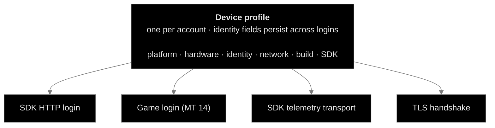

[RoK Toolkit](../../README.md) › [Docs](../README.md) › [Headless](README.md) › Identity and Fingerprint

# Identity and Fingerprint

The method maintains one device profile per account and presents it consistently across every surface: the SDK HTTP login, the game login (MT 14), the SDK's telemetry transport, and the TLS handshake.

**On this page:** [Device profile](#the-device-profile) · [Where fields surface](#where-each-field-surfaces) · [Consistency rules](#consistency-rules) · [Open boundaries](#open-boundaries)

## The device profile

Identity fields persist across logins.

| Group | Fields | Notes |
| --- | --- | --- |
| Platform | `platform` (`android` / `pc`), `os.family`, `os.version`, `os.build` | Selects the CPU field mapping and TLS baseline. |
| Hardware | `cpu.arch` (`arm64-v8a` / `x86-64`), `cpu.name` (PC), `cpu.socBrand` (Android), `screen.widthPx`, `screen.heightPx`, `screen.dpi` | Screen pair sorted largest-first on the wire. |
| Identity | `ids.deviceId` (the `udid`), `ids.androidId`, `ids.googleAid` / `ids.idfa` (platform-dependent), `ids.sdkDeviceIdHex`, `ids.pushToken` | Formats per platform below. The same `deviceId` appears in three MT 14 slots. |
| Network | `network.publicIp`, `network.publicPort` | The exit address; compared against the socket peer. |
| Build | `app.version`, `app.versionCode`, `app.resourceVersion`, `app.distribution` (`global` / `kr`), `app.regionTag` | Three version namespaces: `version` is dotted (MT 14), `versionCode` is the integer the SDK login carries, `resourceVersion` pairs with the release. `regionTag` is `KOREA` on the KR build only, never inferred from locale. |
| SDK | `sdk.version`, UA template parts, host, header constants | Distinct version namespace from the app version. |

### ID formats per platform

**MEASURED** · audited captures on all three platforms

| Platform | `deviceId` (udid) | Other IDs |
| --- | --- | --- |
| Android | 32 hex characters | `androidId` 16 hex, `googleAid` a UUID, `idfa` empty (inapplicable on this platform) |
| PC | 17 digits | `idfa` 38 URL-safe characters; no Android IDs |
| iOS (captures) | dashed UUID | `idfa` 32 hex or dashed UUID; no Android IDs |

> [!WARNING]
> All-zero values, whitespace padding, and placeholder strings do not occur in genuine captures. An ID from another platform's namespace (an Android `androidId` on a PC profile) is a contradiction no real client produces.

## Where each field surfaces

### MT 14 (game login)

| Wire field | Source | Rule |
| --- | --- | --- |
| `4`, `6.13`, `6.23` | `ids.deviceId` | Identical value in all three slots. |
| `6.4` | `ids.idfa` | `Device.IDFA`; empty on Android. The Android IDs surface in the SDK login body ([Step 1](01-login.md#step-1-account-login)), not MT 14. |
| `6.7`, `6.22`, `13` | `network.publicIp` (+ port) | The public exit address, never a private bind address. |
| `6.18` | PC: `cpu.arch`; Android phone: `cpu.arch` (the captured layout sends the ABI); Android legacy layout: `cpu.socBrand` | The captured-phone layout is canonical; the legacy layout's SoC-brand slot is that approximation's own choice. |
| `6.24` | PC: `cpu.name`; Android phone: `cpu.name` with `arm64-v8a` fallback; Android legacy layout: `arm64-v8a` | Same precedence: the measured model with its fallback, the legacy approximation unconditionally the ABI. |
| `6.19` / `6.20` | `max(...)` / `min(...)` of the pixel dimensions (phone layout). The legacy layout instead used `6.25`/`6.26` for height and `MachineGuid`; on the phone layout `6.26` is absent. | Sort the pair largest-first; do not treat the legacy slots as canonical. |
| `12` | `app.resourceVersion` | Must pair with the release, not be an arbitrary number. |
| `27.2` | `app.regionTag` | Present only on the KR build. |

### SDK HTTP transport

The SDK login and telemetry requests carry a User-Agent (`Dalvik/2.1.0 (Linux; U; Android <ver>; <model> Build/<build>)` on Android), fixed header constants, an epoch-millisecond timestamp anchored by a server time call, and a 16-byte constant encoded as base64. The device report itself is opaque ciphertext; its decoded fields are not recoverable from captures.

### TLS

**MEASURED**

TLS 1.2, cipher `0xC030`, a fresh connection per SDK request.

- One implementation of the Android SDK **honors the device HTTP proxy**, though one capture-based reading said it ignores it; the measured ClientHello baseline is the safer reference
- The native token provider's return-code byte order is unresolved despite one big-endian reading

## Consistency rules

> [!IMPORTANT]
> **PASS** means supported match, **FAIL** means supported contradiction, **UNKNOWN** means insufficient visibility and is never converted to a pass.

| ID | Assertion |
| --- | --- |
| I01 | MT 14 fields `4`, `6.13`, `6.23` are all the same `deviceId`. |
| I02 | Every IP reported in MT 14 equals the contemporaneous socket peer address. |
| I03 | The SDK User-Agent model equals the login model wherever both are visible. |
| I04 | CPU fields follow the platform branch; an Android UA with a PC CPU tuple is a strong anomaly. |
| I05 | MT 14 `6.19 >= 6.20`, and the pair matches the screen dimensions the telemetry reports. |
| I06 | Identity fields stay stable across one account's simultaneous surfaces; only request-scoped values vary. |

## Open boundaries

The SDK report's inner fields and the SDK-ID to login-ID relationship remain **UNKNOWN**.

---

**Related:** [login sequence and profile fields](01-login.md).

[← Wire Protocol and Cipher](02-wire-protocol.md) &nbsp;·&nbsp; [↑ The Headless Method](README.md) &nbsp;·&nbsp; [Message Registry →](04-message-registry.md)

