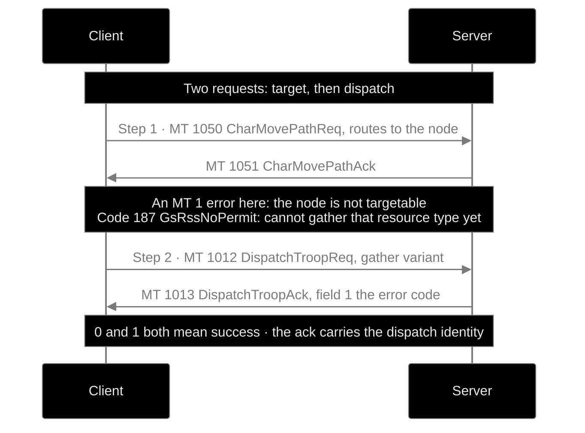

<sub>[RoK Toolkit](../../../README.md) › [Docs](../../README.md) › [Headless](../README.md) › [Game Systems](README.md) › Gathering and Marches</sub>


# Gathering and Marches

**MEASURED (proto schema)** throughout.

**On this page:** [Two-step march](#dispatch_gather-the-two-step-march) · [Commanders](#commanders-query_hero_list-mt-366--367) · [Login flood](#the-login-flood) · [Node search](#search_resource_nodes-mt-1176--1177) · [Barbarian search](#search_barbarian-mt-1178-searchnpcreq) · [Combat dispatch](#_send_combat_dispatch-mt-1012-combat-variant) · [Walkout](#_send_walkout-mt-1012-untargeted-walkout) · [Group attack](#barb_wirebuild_multi_move-mt-1017-multimovereq-group-attack) · [Barbarian completion](#barbarian-completion-mt-1170--7602-pushes) · [Move](#march_move-mt-1007-movereq) · [Stop](#march_stop-mt-1009-movestopreq) · [Recall](#recall_marches-mt-1014--mt-1019) · [March index](#the-march-index-mt-1005) · [Route data](#server-route-data-mapsquaref4-and-mt-1083) · [Transport](#resource-transport-mt-1056-transportreq) · [Slots](#slot-and-capacity-semantics) · [Troop capacity](#march-troop-capacity-computed-not-on-the-wire) · [Speed](#march-speed-the-clients-own-formula) · [Buffs](#account-buffs-mt-904-buffntf) · [Resources](#resource-accounting)

## `dispatch_gather`: the two-step march

**MEASURED**

Gathering uses two requests: target, then dispatch.



**Step 1: MT 1050 `CharMovePathReq`** routes to the node:

```text
f1 = player_id (varint)
f2 = node_id (varint)
f3 = src position bytes (city coords)
f4 = dst position bytes (node coords)
f5 = 0
```

Replied by MT 1051 `CharMovePathAck`. An MT 1 error here means the node is not targetable; code 187 (`GsRssNoPermit`) means the account cannot gather that resource type yet.

**Step 2: MT 1012 `DispatchTroopReq`**, gather variant captured from the real Android client (max-CH25 farm):

```text
f1 (repeated) = TroopHero blocks:
     main:   f1=hero_id, f2=1 (Label=Main),  f3=0
     assist: f1=assist_hero_id, f2=2 (Label=Assit), f3=0   [optional]
f2 (repeated) = unit blocks: f1=unit_id or unit-category id, f2=count   [the gather variant accepts category ids; targeted dispatches send concrete unit ids]
f3 = dst position bytes (0,0; the server uses TargetId)
f4 = node_id (varint)
f5 = "dispatch_troop_1" (bytes)
f14 = 1   [gather-mode flag: always 1 for gathers]
```

Replied by MT 1013 `DispatchTroopAck`; field 1 is the error code where 0 and 1 both mean success. The ack carries the dispatch identity: `Code f1`; the troop id at `Square f2 → Char f1 → Id f1`, with fallback `Square.f8.f1`, and fallback `Square.f11.f3`; the destination at `1013.f3`.

When the primary commander is level 20+, a second idle commander attaches at no march-slot cost. Refusals `9950-9965` (`AssistHero*`) identify the secondary commander. Codes `155`/`156` (`HERO_NOT_OWNED`/`HERO_BUSY`) could refer to either commander. The ambiguous pair is resolved by one probe: resend the primary alone. A success means the secondary was at fault.

## Commanders: `query_hero_list`: MT 366 / 367

MT 366 `HeroListReq` with an empty body; MT 367 `HeroListAck` returns repeated `HeroInfo` records:

| HeroInfo field | Meaning |
| --- | --- |
| f1 `HeroId` | the commander id used in dispatch `f1` blocks |
| f2 `Level` | gates the assist slot at 20+ |
| f8 `HeroState` | 1 Home, 2 Garrison, 3 Move. Only Home heroes dispatch |
| f9 `Awaked` | awakening flag |
| f16 (repeated) | equipped gear entries; the count is the gear check |

MT 367 often arrives in the login flood. If partial, MT 366 refreshes the full roster.

> [!IMPORTANT]
> Treat flood data as stale until re-read.

## The login flood

The burst after the MT 14 ack is the game-info snapshot: city and buildings (MT 204), resources (MT 121), heroes (MT 367), troops and marches (MT 1005), map objects (MT 1003), mail, quests, buffs (MT 904), and switches (MT 22). These arrive as separate partial updates, often inside MT 9999 wrappers. The [login sequence](../01-login.md#step-5-after-the-ack) documents the timing; the rule is: apply what arrives, keep what has not arrived unknown, and re-read explicitly (MT 203 for city, MT 366 for heroes, MT 1176 for nodes) before acting.

## `search_resource_nodes`: MT 1176 / 1177

**MEASURED** · proto schema

Searches any resource type, including gems.

**`SearchRssReq` (1176):** `f1 ResType` (enum: 1 Food, 2 Wood, 3 Stone, 4 Gold, 5 Gems), `f2 Level` (int32, minimum, with higher values possible in the reply).

**`SearchRssAck` (1177):** `f1` repeated `SearchNode`: `f1 Pos` (`PosInfo` position bytes), `f2 CharId` (the `node_id` used as dispatch target), `f3 Rss` (optional `NodeRssInfo`: `f1 Remain` / `f2 Max`, both protobuf **doubles**, wire type 1. Reinterpret the uint64 bit pattern as IEEE-754). The true node level is derived from `Max` capacity. `init_world_map` (MT 1001/1002) must precede the search, and heavy sessions can take tens of seconds for the 1177.

## `search_barbarian`: MT 1178 `SearchNPCReq`

**MEASURED** · proto schema

```text
f1 = NpcType (enum)
f2 = level (int32)
f3 = Value (int32, optional)
f4 = Nearby (bool, optional)
```

The engine sends `1, level, 1, 1`. **`SearchNPCAck` (1179):** `f1` repeated `SearchNode` (same shape as the rss ack: Pos + CharId), `f2 NpcType`, `f3 Level`, `f4 ExtraCode` (ErrorCode). The list is sorted closest-first. A search can return locked levels. The level gate applies on attack.

## `_send_combat_dispatch`: MT 1012, combat variant

Same carrier as the gather dispatch, with combat-specific extras:

```text
(heros, units, dst, target_id, request tag "attack_barb_1")
f6 = 1, f7 = 0, f11 = 0, f14 = 1, f17 = 1
```

The gather variant omits `f6/f7/f11/f17` and sends `f14=1` only.

## `_send_walkout`: MT 1012, untargeted walkout

The third dispatch form: no target at all, troops walk out and stand. The route 1050 uses the castle CharId as source and destination id `-1`. The dispatch omits TargetId, sends real destination coordinates in `f3`, `IdleStation f7=1`, `PowerEvaluation f17=3`, `FeastPartyStation f14=1`, `Offensive f6=0`, `BuildStation f11=0`, extension `f18=0`, tag `"dispatch_troop_1"`.

## `barb_wire.build_multi_move`: MT 1017 `MultiMoveReq`, group attack

Retarget several marches at once: repeated `TroopIds f1`, zero `Src f2` / `Dst f3`, `TargetId f4`, `Offensive f8=1`, `IdleStation f9=1` (the group attack pins idle-stay behaviour; the same field serves as an optional world-position pin in other call sites), `WaitSiege f10=0`, `BuildStation f11=0`, `IsAutoPVE f16=0`. **Ack (1021):** accepted troop ids are `f2[].f1`. A march absent from the list was not accepted.

## Barbarian completion: MT 1170 / 7602 pushes

Two pushes mark a barbarian dead: MT 1170 carries the barbarian CharId `f1` and a player id `f2`; MT 7602 carries the barbarian id `f1`. The engine credits the kill based on the barbarian's disappearance, regardless of whether 1170's player id is the governor.

## `march_move`: MT 1007 `MoveReq`

**MEASURED** · proto schema

Retarget an already-deployed march:

| Field | Type | Notes |
| --- | --- | --- |
| 1 `TroopId` | int64, required | |
| 2 `Src` / 3 `Dst` | `PosInfo`, required | Zeros in the target-only form; the server uses TargetId |
| 4 `TargetId` | int64, optional | The new destination object |
| 5 `AutoCounter` / 6 `AutoAttack` / 7 `RallyReinforce` | bool | false in captured sends |
| 8 `Offensive` / 9 `IdleStation` / 10 `BuildStation` | bool | false |
| 11 `ReinforceType` | enum | |
| 12 `AggressiveMove` / 14 `NoAggression` / 15 `IsAutoPVE` | bool | false |
| 13 `FeastPartyStation` | bool | **true** (identifies the target-only form) |
| 16 `MoveBitFlag` | int64 | |

Measured send order: `1, 3, 2, 13, 4, 8, 10, 15, 9, 5`. **`MoveAck` (1020):** `f1 Dst` (`PosInfo`), `f2` repeated `TroopMetaInfo` (`f1 TroopId`, `f2 SameTagert`, `f3 Src`, `f4 IsStraight`, `f5 BuffFail`). Silence: outcome unknown, not failed.

The **drag form** (exercised only as a probe, separate from the captured target-only form above): `TroopId f1`, zero `Src f2`, explicit `Dst f3`, optional `TargetId f4`, `Offensive f8=0`, configurable `IdleStation f9`, `FeastPartyStation f13=1`, `IsAutoPVE f15=0`; optionally preceded by a 1050/1051 route. Target-plus-destination and select-before-move variants exist as well.

## `march_stop`: MT 1009 `MoveStopReq`

**MEASURED** · proto schema

`f1 TroopId` (int64). Confirmation is a plain MT 1 OK. There is no separate stop-ack message. The follow-up state arrives as `MoveStopNtf` (`f1 CharId`, `f2 Pos`, `f3 Tick`) when it arrives at all. Silence is unknown.

> [!WARNING]
> After success, a snapshot read shows station state 4; a later snapshot failure must not erase the confirmed result or trigger a second stop.

## `recall_marches`: MT 1014 / MT 1019

One troop: MT 1014 with `f1=troop_id, f2=0`. Several: MT 1019, repeated `f1=troop_id` plus `f2=0`, the real client's recall-all shape. Confirmation is generic MT 1 `{f1=<req mt>, f2=1}` followed by MT 1005 state pushes. Accepted ≠ home: `wait_until_home` re-reads the march index before reporting. A measured recall 44 min into a 2 h 16 min gather window delivered 576,326 wood as partial cargo; the gather credit lands on return, not during.

## The march index: MT 1005

**MEASURED**

The live march list, pushed in the login flood and on every march change. Outer `f1` repeated entries:

| Field | Meaning |
| --- | --- |
| `f1 TroopId`, `f2 Action`, `f4 State` | Identity and state. States: 1 Idle, 2 Move, 3 Attack, 4 Station, 5 Dead, 6 Gather, 7 Rally, 8 Reinforce, 9 Recover. Idle and Dead hold no march slot; the other observed states do |
| `f3` | The troop/heroes block |
| `f5 Load`, `f6 Collected`, `f7 CollectStartTime`, `f8 CollectSpeed` | Gather cargo accounting (doubles: reinterpret bits) |
| `f9 Carrier`, `f10 Target` | The resource node once gathering (f9) versus the destination object while moving (f10); either block carries `f3 CharType 6`, `f6` resource type, `f7` level. `f11/f12` are the **gather** start/end epoch ms, not the walking arrival window |
| `f11 StartTime`, `f12 EndTime` | The gather window (see `f9/f10` row); the walking arrival time is computed from route data, not these fields |
| `f13 CharId`, `f14 CharType` | Owner |
| `f15 Pos`, `f19 APR` | Position and action-point rate |

> [!WARNING]
> `Action = 2` **deletes** the entry; apply removals last, after the adds and updates in the same push.

The index is push-only in the measured exchange: consume fresh state from pushes; no query request for it was observed. A march that arrives at a node another march took stays in state 4 Station with no target and no `f11/f12`, holding its slot while gathering nothing; the conjunction, not Station alone, identifies it.

## Server route data: `MapSquare.f4` and MT 1083

Marches carry their own route: `MapSquare.f4 Move` (and `MapSquare.f2 PlayerId`, `f8` troops, `f24` target) plus the MT 1083 push, `f1 MapSquareMove` (`f1 CharId`, `f2 Move`, `f8 TargetId`) with outer `f2 Tick`. While a march walks, the pushes arrive at roughly 4 Hz per observed march (measured during fort watches). `MapMove` parses:

| `MapMove` field | Meaning |
| --- | --- |
| `f2` Pos / `f3[]` Path | route waypoints |
| `f4` Speed | float, world units per second |
| `f5` PosTs | epoch ms |
| `f6` PathIdx | last waypoint passed |
| `f10` StartTs | epoch ms |

`PathIdx` is the last waypoint passed: the remaining route is `Pos -> Path[PathIdx+1]` plus every later leg, and

```text
arrival_ms = PosTs + 1000 * remaining_world_units / Speed
```

Whole-route arithmetic from `StartTs` missed measured walks by 6.0 and 46.5 s; the unit-explicit form above did not. Full routes for standing marches are also available in the MT 1002 map snapshot without waiting for 1083 pushes. The server supplies these movement timestamps and the position, so local interpolation is unnecessary. The [Lua runtime method](../../lua-runtime/02-client-reads.md#watching-the-map) reads the same messages from inside the client by wrapping its message dispatch.

## Resource transport: MT 1056 `TransportReq`

Shipping resources to another governor: route 1050 with `f1=0`, `f2=0`, source position `f3`, target position `f4`, `f5=1`; then the transport `TargetPlayerId f1` and a resource block `f2 {ResType f1, Amount f2}`. Ack 1057.

## Slot and capacity semantics

`march_cap_for_ch` gives the march-slot floor by City Hall level: CH 1-4 one march, 5-10 two, 11-16 three, 17-21 four, 22+ five. Server-confirmed slot counts arrive as refusal code 164 (`GsNoFreeMarch`); capacity learning for a commander pair arrives as 163 and stands the pair down for 30 minutes when repeated.

## March troop capacity: computed, not on the wire

**MEASURED** + client code

No message carries the cap. The apparent matches are other fields (`1137/1138` is reinforce capacity and `MapRally f14` is a rally total). The client sends the commander level as 0 in dispatches and the server sizes the march from its own state; refusal code 163 (`GsTroopCapacityLimit`) is the server's answer. The client's formula:

```text
cap = floor( (ArmyCnt[City Hall level] + Lead[leader level] + gear flat 15094)
             * (1 + sum of every 12005 buff that counts)
             + 0.0001 )
```

Flat terms first, the percentages summed into one multiplier, one multiply, one floor. `ArmyCnt[25] + Lead[60]` = 150,000 + 50,000 = 200,000, where both tables end; `15094` is the flat add only equipment awakening gives.

Which `12005` (March_Capacity) terms count:

- Home kingdom: the **leader's** talents 408/502/1608, skills, gear, and armaments; the **assist's skills and nothing else of the assist's**; the VIP node; the first live item node from MT 904
- KvK conquer mode: every live `kvktechnique.*.12005` node sums (measured +15% and +35% across 17,615 dispatches, zero wrong caps once summed); `titan` only on Titan servers
- Not counting: research, civilization, buildings, and alliance tech

Client verification: 24 marches decoded, 17 at the formula’s cap, none above. Pairing adds no slot or flat term of its own; an assist's skills can still raise the summed percentage, and with it the final capacity.

## March speed: the client's own formula

**CODE** · the client's `HeroHandler:GetTroopsMoveSpeed` · **MEASURED** against live marches

Speed is world units per second; the tick interval is 1000 ms unless the server sends another.

```text
for each unit u:  base_u = training_Training.Speed;  type_u = 6000 + unit type (1-4)
                  own_u  = the account buff of type_u
all = account[6000] + treasure(leader, 6000) + armaments(leader, 6000) + treasure(assist, 6000)
      (+ account[14011] when creating a rally, + account[14016] when reinforcing one)
per commander:   each skill effect adds to own_u (its type) or to all (6000);
                 per unit: own_u += treasure(commander, type_u)
leader only:     each talent effect, the same way
slowest = the unit with the least base_u * (1 + own_u)
speed   = base_slowest * (1 + own_slowest + all)
```

The measured rules inside it:

- The slowest unit is picked **before** the all-buffs apply (a unit fast on its own buffs can lose the pick to one with none)
- Every value is additive into one multiplier with no rounding
- The assist brings its skills and treasures but not its talents or armaments
- **The commander's equipment does not count at all** (march-speed gear exists and the send screen shows it as its own tag, but the computed time excludes it; whether the server counts it is UNKNOWN)
- There is no terrain, zone, road, or territory term
- The route distance is the sum of straight segments over the 1051 path reply; the shown time rounds up

The server states its own speed on every walking march (`MapMove.Speed`, world units a second), carried by the [march index](#the-march-index-mt-1005) and the [route data](#server-route-data-mapsquaref4-and-mt-1083): the cross-check.

## Account buffs: MT 904 `BuffNtf`

Unsolicited ~0.2 s after LoginReq (`player`, then `event`); map keys accompany 1002. Repeats after each building completion and item use.

```text
MT 904   f1 Key   "player" | "event" | "map" | "server" | "country" | "mapskill" | "legion"
         f2 Buff  { f1[] BuffData }
BuffData f1 Key   "<source>.<source id>.<buff id>"   e.g. "vip.17.12005"
         f2 Op    2 = percent, 1 = flat
         f3 Type  12005 march capacity, 8000 troop load, 2000-2006 gathering
         f5 Vf    double (fixed64, not varint)
         f6 Expire epoch SECONDS, 0 = permanent
```

> [!IMPORTANT]
> **Each message replaces everything under its outer key.** Keep a single node set per key and replace it in full.

- **Expired nodes keep arriving.** A login snapshot can carry an `item.121.12005` expired months ago next to a live `vip.17.12005`, and summing both gives +55% where the truth is +5%
- Keep a node only while `Expire == 0` or server time < Expire (compare against the **epoch-millisecond** fields of MT 8003, `f2 TickTS`/`f4 GsSendTS`; its `f1 Tick` is a ~1/s sequence counter, not a clock; Expire is epoch **s**)

> [!WARNING]
> **Expiry is not pushed.** Expire nodes against the server clock.

For item buffs the source id is the item id (measured: item 113 used, `item.113.*` arrived 31 ms later with Expire = use time + the item's duration).

Known values:

| Source | Value |
| --- | --- |
| VIP 14-17 | 0.05 |
| VIP 18+ | 0.15 |
| Army Expansion 120 | +0.25 for 4 h |
| Army Expansion 121 | +0.50 for 4 h |

The item term is only the **first live** item node. Gathering boosts ride target 2000 with the same node shape: item 112 is a 24 h +50% gathering boost, and the measured 50% raised a ~+355% account's rate by about x1.11 (adding 0.50 to the bonus pool), not x1.5 on output.

## Resource accounting

**MEASURED**

MT 121 `ResourceNtf` carries **absolute balances, present types only**. Replace each present type's balance. MT 2088 is the protected **floor** with the same `{f1 type, f2 amount}` shape (measured floor: 11M food / 11M wood / 8.25M stone / 5.5M gold); raidable = the 121 gross minus the 2088 floor per type. Production is credited when collected (MT 120/122); gathered cargo is credited only when the march returns. The [march index](#the-march-index-mt-1005)'s `Load`/`Collected` fields are the in-flight accounting.

---

**Related:** [Invoking the Client](../../lua-runtime/03-client-calls.md).

<div align="center">

[← State Reads](01-state-reads.md) &nbsp;·&nbsp; [↑ Game Systems](README.md) &nbsp;·&nbsp; [Fort Operations →](03-forts.md)

</div>
