<sub>[RoK Toolkit](../../../README.md) › [Docs](../../README.md) › [Headless](../README.md) › [Game Systems](README.md) › Fort Operations</sub>


# Fort Operations

**MEASURED (proto schema + captures)** throughout.

Barbarian fort rallies.

**On this page:** [Finding forts](#finding-forts-on-the-map) · [Lead sequence](#the-lead-sequence) · [Create](#fort_rally-create-mt-1100-createrallyreq) · [Rally state](#rally-state-mt-1101--1102-and-the-mt-1105-push) · [Join](#fort_join-reinforce-mt-1108--1109) · [Kick and cancel](#kick-mt-1112-kickrallyreinforcereq) · [Outcomes](#outcomes-arrive-as-mail-not-on-the-march) · [Action points](#action-points-mt-8030--8031-and-the-free-claim-907--908) · [Capacity](#capacity-semantics)

```mermaid
%%{init: {"theme":"base","themeVariables":{"primaryColor":"#000000","primaryTextColor":"#e8e8e8","primaryBorderColor":"#7a7a7a","secondaryColor":"#000000","tertiaryColor":"#000000","lineColor":"#7a7a7a","textColor":"#7a7a7a","titleColor":"#e8e8e8","edgeLabelBackground":"#000000","clusterBkg":"#000000","clusterBorder":"#7a7a7a","actorBkg":"#000000","actorBorder":"#7a7a7a","actorTextColor":"#e8e8e8","actorLineColor":"#7a7a7a","signalColor":"#7a7a7a","signalTextColor":"#7a7a7a","noteBkgColor":"#000000","noteBorderColor":"#7a7a7a","noteTextColor":"#e8e8e8","transitionColor":"#7a7a7a","transitionLabelColor":"#7a7a7a","stateLabelColor":"#e8e8e8","stateBkg":"#000000"},"flowchart":{"wrappingWidth":520}}}%%
%% source: lead sequence code block: "MT 1178  fort search ... -> 1179", "MT 1050  target select (fort variant) -> 1051", "MT 9726  pre-create probe, empty body", "MT 1100  rally create -> 1005 march"
%% source: "A new march confirms acceptance. The method looks for a fresh MT 1005 troop entry whose target matches the fort"
%% source: "Membership confirms itself off the next MT 1105 roster push: joining appears on acceptance, before arrival, as a new member entry"
%% source: "Confirmation is the roster, again: the next MT 1105 shows the member gone"
%% source: "Cancel (MT 1103): empty body." "Success is observed as the rally disappearing from subsequent 1101/1105 state."
flowchart TD
    subgraph Lead["The lead sequence"]
        A["MT 1178 fort search<br/>reply 1179"] --> B["MT 1050 target select, fort variant<br/>reply 1051"]
        B --> C["MT 9726 pre-create probe<br/>empty body"]
        C --> D["MT 1100 rally create"]
        D --> E["A fresh MT 1005 troop entry<br/>whose target matches the fort"]
    end
    subgraph Ops["Confirmed by rally state"]
        direction LR
        J["MT 1108 join"] --> J2["Next MT 1105 roster push<br/>a new member entry"]
        K["MT 1112 kick"] --> K2["Next MT 1105<br/>the member gone"]
        X["MT 1103 cancel"] --> X2["The rally disappears from<br/>subsequent 1101 / 1105 state"]
    end
```



## Finding forts on the map

[Map reads](01-state-reads.md#map-view-mt-1004--1003) carry forts as `1003.f2` squares, not separate fortress objects:

| `MapSquare` field | Meaning |
| --- | --- |
| `f1 Char` | The fort's map object: `f1 Id`, `f3 Pos` |
| `f2 PlayerId` | Always `-2` for NPC forts |
| `f13 NpcInfo` | `f1 NpcType`, `f3 BType = 2` |
| `f16 IsFighting` | Occupied by an active rally |

Fort level is off-wire: the bundled `fort_levels.json` maps NPC config ID (`NpcType`) to level.

## The lead sequence

```text
MT 1178  fort search   { f1: 2, f2: LEVEL, f3: 1, f4: 1 }   -> 1179
MT 1050  target select (fort variant)                       -> 1051
MT 9726  pre-create probe, empty body
MT 1100  rally create                                        -> 1005 march
```

The search sends `NpcType = 2` (the fort family); the 1179 top-level `Level f3` applies to every target it returns. The target-select 1050 differs from the [gather route](02-marches.md#dispatch_gather-the-two-step-march): `f1` the source id, `f2` the fort's CharId, `f3` a zero source position, `f4` the fort position, `f5 = 0`. The 9726/9727 pair is empty in captures.

## `fort_rally` create: MT 1100 `CreateRallyReq`

| Field | Type | Notes |
| --- | --- | --- |
| 1 `Heros` | repeated `TroopHero` | `f1 HeroId`, `f2 Label` (1 Main / 2 Assit), `f3 Slot` |
| 2 `Units` | repeated `Unit` | `f1 UnitId`, `f2 Count` |
| 3 `TargetId` | int64, required | The fort CharId |
| 4 `PrepareTime` | int64, required | **Milliseconds**; engine default 300000 (5 min) |
| 5 `Tag` | string | `"dispatch_troop_1"` |
| 6 `RemUnitTypeList` | repeated int32 | Allowed joiner troop types: infantry 1, cavalry 2, archers 3 (echoed by MT 1105 `f17`) |
| 7 `StripSkills` | repeated int32 | |
| 8 `CampTroopId` | int64, optional | Reuse a camped march |
| 9 `Tactics` | int32, optional | |
| 10-12 `CaptainId`, `CarrierId`, `CarrierPos` | | Carrier rally variants |
| 13 `ObstacleMode` | enum | |

Builder emission order is `1, 6, 4, 5, 3, 2` (fields), `1, 3, 2` inside hero blocks, `2, 1` inside unit blocks. The builder preserves the captured order. **A rally sends concrete unit ids; a gather sends a troop category** (`MT 1012` with `{4: Siege}` versus `MT 1100` with `{18: 22000}`), so a fort preset must resolve to a unit list.

> [!IMPORTANT]
> **A new march confirms acceptance.** The method looks for a fresh MT 1005 troop entry whose target matches the fort and does not rely on a successful-create CommAck (plain MT 1).

An account can create a rally alone. The rally departs only after a second governor joins.

## Rally state: MT 1101 / 1102, and the MT 1105 push

The list read (1101, empty) answers 1102: `f1 RallyList`, `f2 BeRallyList`. **An empty 1102 replaces the previous list** because it is a snapshot. The same `MapRally` shape arrives as pushes on MT 1105 whenever rally membership changes:

| `MapRally` field | Meaning |
| --- | --- |
| `f1` | Captain player id |
| `f2` | Captain name |
| `f3` | Captain position |
| `f4` | The captain's city CharId |
| `f6` | Target: `f1 CharType`, `f2 Id`, `f3 Pos`, `f4 Name`, `f9 IsNpc`, `f13` NPC info (`f1`, `f3`) |
| `f8` | Members (below) |
| `f10` / `f11` | Prepare window start / end (epoch ms) |
| `f12` | March start |
| `f14` / `f15` | Troop count / march limits |
| `f17` | Allowed joiner troop types (echo of create `f6`) |
| `f26` | Alliance id |

Each member in `f8`: `f1 TroopId`, `f2 PlayerId`, `f7 PlayerName`, `f5 Units` (or the compact `f14` form), each unit `{f1 UnitId, f2 Count}`. MT 1105 is a **full roster snapshot**. Decode members, not frame length (732→1580 bytes for 1→2 members).

## `fort_join` reinforce: MT 1108 / 1109

Joining uses a separate pair from creation and identifies the rally solely by the **captain's player id**: `f1 Heros`, `f2 Units`, `f3 RallyCaptain` (the captain), `f5 Tag`, `f6 StripSkills`, `f7 ExtSkill`, `f8 ObstacleMode`, `f9 Tactics`, `f10 ChangeTroopId`, `f11 JoinType`, `f12 NoAggression`. **Ack (1109):** `f1` a `MapSquare` (the joining troop's map object).

Membership confirms itself off the next MT 1105 roster push: joining appears on acceptance, before arrival, as a new member entry with its `TroopId`.

## Kick: MT 1112 `KickRallyReinforceReq`

`f1 BeKickPlayerId`, `f2 CaptainId`, `f3 BeKickTroopId`. (One schema variant names this message `ChangeRallyRemUnitReq`; that binding was rejected: that message carries Initiator and a RemUnitTypeList instead.) The kick requires a roster read because all three ids come from the last MT 1105.

> [!CAUTION]
> The bytes emit field **2 first** (`2, 1, 3`): a builder that assigns field numbers by position would send the captain as `f1` and ask the server to remove the captain.

Confirmation is the roster, again: the next MT 1105 shows the member gone (observed 30 ms after the send, then a resent copy). No second 1101 round trip is needed. Unknown: whether a kicked player can rejoin, what the server answers for a non-member target or a non-captain sender, and whether the removed troops walk home.

**Cancel (MT 1103):** empty body. Generic MT 1 acks; the registry's 1104 assignment is not the cancel acknowledgement (see [registry conflicts](../04-message-registry.md#registry-conflicts-and-limits)). Success is observed as the rally disappearing from subsequent 1101/1105 state.

**Brief (1150/1151):** empty pair in captures.

## Outcomes arrive as mail, not on the march

MT 1083 sends positions (~4 Hz), then goes quiet without a completion event. March updates count starts, not wins. Each fort win produced **three MT 7909 `MailNtf` pushes inside the same second**:

| Size | Body | What it carries |
| --- | --- | --- |
| ~265 B | `{"damage_rate":55.146748,"npc_type":103,"order":6,"pos":{...}}` | The reward mail: `damage_rate` the contribution share (matches the UI's rendered percentage), `order` the trophy tier, `npc_type` 103 the barbarian fort |
| ~4 KB | `{"Id":4790797,"GsId":959,...,"Attacks","Events","Bts","Ets","Samples"}` | The full battle replay. `Bts`/`Ets` are battle start/end epochs, so fight duration needs no local timing |
| ~175 B | `{"action":6,"max":20,"now":4,"ts":...,"typ":3,"v":7}` | A daily allowance counter, `now` of `max`; `action` was 6 on exactly the rally wins and 2 on other events. Which allowance is **UNKNOWN** |

The envelope is a `MailEntity` (id, `"system"` sender, `player_<id>` recipient, JSON body; body may be raw JSON or `{template, flag, json}`). A rally that expires unjoined emits `rally_cancel.no_reinforce` on MT 8016 and a refund mail with `{"ap":140}` outright. **MT 1104** arrives in the same millisecond as the mails: `f1` a player id (own on rallies led, the captain's on rallies joined), `f2` a seconds clock. It hints at a change for that player. The mail is authoritative.

## Action points: MT 8030 / 8031, and the free claim 907 / 908

**`MT 8030` (empty) provokes `MT 8031 PVEInfo`:**

| Field | Meaning |
| --- | --- |
| `f1 AP`, `f2 MaxAP`, `f3 APSpeed` | **float32** (wire type 5). Reinterpret the bits. `APSpeed` is per **hour** |
| `f4 BarLevel` | Barbarian level gate |
| `f5` | Sync anchor, epoch ms |

The push fires on change (login, dispatch), so it carries its own slope and origin:

```text
if AP > MaxAP:  AP(t) = AP                                  # bottle-boosted: no regen, do not clamp
else:           AP(t) = min(MaxAP, AP + APSpeed * (t - anchor) / 3,600,000)
```

- `t`, `anchor`, `f5`: epoch ms; the divisor converts elapsed ms to hours for the hourly `APSpeed`
- Compute from `f5`, never the packet timestamp: a login push carries the anchor from the previous session
- Value, cap, and rate vary per account

**Cost is derived, not constant:**

```text
cost = AP_expected_by_regen - AP_now        # attribute to the action just taken
```

> [!WARNING]
> Measured creates cost 150.00 and 140.00 on the same account, so a fixed constant is wrong half the time.

The expiry refund is exact, confirmed three ways:

| Confirmation | Carrier |
| --- | --- |
| Regen delta | 8031 before/after |
| Expiry event | 8016 `rally_cancel.no_reinforce` |
| Refund mail | `{"ap":140}` |

**Free AP claim:** MT 907 `f1 Free = 1`, ack 908 `f2` the granted AP. AP bottles are ordinary [item use](05-claims.md#item-use-mt-100-useitemreq) (MT 100/103); the balance arrives separately on 8031.

## Capacity semantics

Rally joins obey the same march-slot floor as any march (`march_cap_for_ch` in [marches](02-marches.md)). AP cost per rally **varies and is derived from the 8031 delta** (see above).

---

**Related:** [Invoking the Client](../../lua-runtime/03-client-calls.md).

<div align="center">

[← Gathering and Marches](02-marches.md) &nbsp;·&nbsp; [↑ Game Systems](README.md) &nbsp;·&nbsp; [City Development →](04-city.md)

</div>
