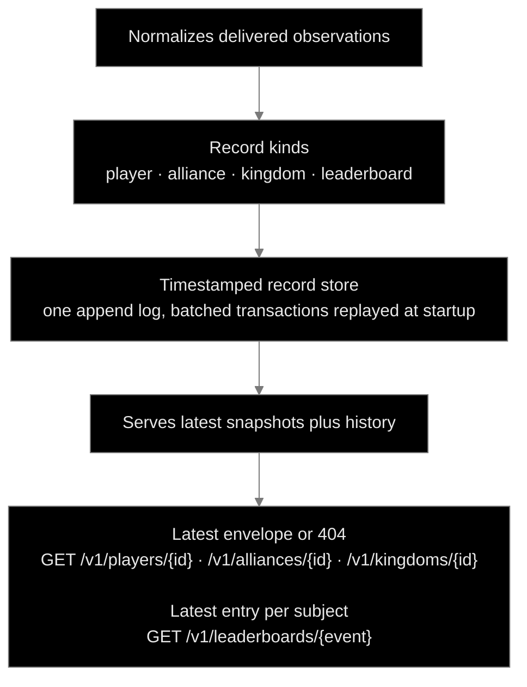

<sub>[RoK Toolkit](../../../README.md) › [Docs](../../README.md) › [Headless](../README.md) › [Game Systems](README.md) › The RoK-Data Store</sub>


# The RoK-Data Store

The consumer half of [data gathering](06-data-gathering.md): a Go 1.22+ standard-library service that normalizes delivered observations into a timestamped record store and serves latest snapshots plus history. It uses one process and one append log, without a framework.



## The record kinds

| Kind | Required fields | Optional |
| --- | --- | --- |
| `player` | `id`, `name`, `kingdom_id`, `power` | `alliance_id` |
| `alliance` | `id`, `name`, `kingdom_id`, `members`, `power` | (none) |
| `kingdom` | `id`, `name`, `population` | (none) |
| `leaderboard` | `event`, `subject_kind`, `subject_id`, `rank`, `score` | (none) |

A delivered record (synthetic example):

```json
{"kind":"player","id":"12","name":"Ada","kingdom_id":"7","alliance_id":"3","power":"9500","observed_at":"<iso-timestamp>"}
{"kind":"leaderboard","event":"<event-key>","subject_kind":"player","subject_id":"12","rank":1,"score":"25000","observed_at":"<iso-timestamp>"}
```

- Counters: nonnegative int64.
- Ranks start at 1.
- Stable IDs: `kind_` + SHA-256 of `[namespace, kind, externalID]`.
- Renames and alliance moves preserve history.

## Storage and API

- Replay batched transactions from the append log at startup.
- Reject malformed logs without truncation.
- For `(kind, id, observed_at)`, identical repeats are no-ops.
- Conflicts fail the page with `ErrConflict`.

| Route | Result |
| --- | --- |
| `GET /v1/players/{id}` | Latest player envelope or 404 |
| `GET /v1/alliances/{id}` | Latest alliance envelope or 404 |
| `GET /v1/kingdoms/{id}` | Latest kingdom envelope or 404 |
| `GET /v1/leaderboards/{event}` | Latest entry per subject, sorted by rank then ID |
| `GET /healthz` | 200 when open, otherwise 503 |

Configuration defaults: `127.0.0.1:8080`, `var/records.jsonl`, namespace `public-game`, 300 s ± 30 s polling, sources as `{name, type: file|http, location}`.

## Operating limits

Single process, one owner per log.

> [!CAUTION]
> No retention policy, automatic compaction, trend routes, dashboard, or authentication.

---

<div align="center">

[← Data Gathering](06-data-gathering.md) &nbsp;·&nbsp; [↑ Game Systems](README.md) &nbsp;·&nbsp; [The Lua Runtime Method →](../../lua-runtime/README.md)

</div>
