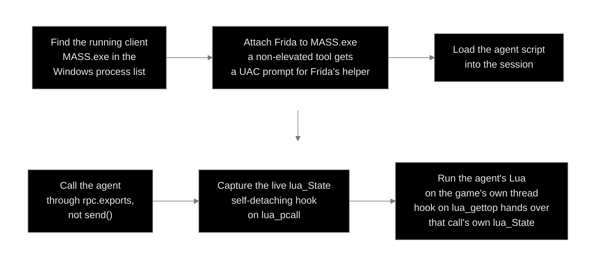

[RoK Toolkit](../../README.md) › [Docs](../README.md) › [Lua Runtime](README.md) › Attach and the Execution Hook

# Attach and the Execution Hook

Code execution in the running PC client.

**On this page:** [Finding the client](#finding-and-starting-the-client) · [Elevation](#elevation) · [Attachment](#the-attachment) · [Execution hook](#the-execution-hook) · [Lifecycle](#lifecycle) · [Detach order](#detach-order)

## Finding and starting the client

| Step | Operation |
| --- | --- |
| 1 | The PC client is `MASS.exe`; its launcher is `launcher.exe` |
| 2 | Find a running client through the Windows process list, not through Frida's own process enumeration (its documented form did not null-check the list pointer and could abort the caller on a bad allocation) |
| 3 | Resolve the install from the uninstall registry (`SOFTWARE\Microsoft\Windows\CurrentVersion\Uninstall`, 64-bit view then 32-bit view, entries whose `DisplayName` contains `rise of kingdoms`, reading `InstallLocation`), then the fallbacks `%ProgramFiles(x86)%\Rise of Kingdoms` and `%ProgramFiles%\Rise of Kingdoms` |
| 4 | Check the executable exists before selecting the path; never take an install path supplied by a window |
| 5 | Start the game through `launcher.exe` only. Running `MASS.exe` directly was measured: the client closes within seconds and the launcher comes up in its place |

Whether the launcher then starts the game follows its own `Automatic start` setting (`automaticStart` in `save/EnvConfig.json` under the launcher directory). Read it, do not write it.

## Elevation

| Fact | Value |
| --- | --- |
| Launcher manifest | `requireAdministrator` |
| `CreateProcess` on the launcher | Refused with error `740`; it does not elevate |
| Working launch call | `ShellExecuteW` |
| The game's integrity level | Elevated |
| Non-elevated tool attaching | Frida asks Windows to elevate its helper: a UAC prompt, then the helper installs two services `frida-<id>-x86` and `frida-<id>-x86_64` running from `%TEMP%\frida-<id>\` (about 55 MB) |
| Elevated tool | No helper-elevation prompt |
| Cleanup | Frida removes its services and folder on clean shutdown; a killed tool process leaves them. One measured machine had accumulated 47 service pairs and 633 folders (5.6 GB) |
| Slow reconnects | 3 to 7 minutes, traced to two restarts close together with the killed run part-way through Windows elevation. The delay is in Windows elevation, not the agent |

## The attachment

**MEASURED**

The attachment uses [Frida](https://frida.re): attach to the running process, load an agent script into it, and talk to the agent over its RPC channel.

1. Attach Frida to the running `MASS.exe`.
2. Load the agent script into the session.
3. Call the agent through `rpc.exports`; results return the same way. The push channel (`send()`) aborted the receiving process in the measured client and is not used.
4. Wait for the agent to capture a live `lua_State` pointer (next section). Attach or capture failure retries once after 2 seconds.

## The execution hook

**MEASURED**

| Mechanism | Operation |
| --- | --- |
| State capture | A self-detaching hook on `lua_pcall` reads the call's first argument as the live `lua_State` pointer, saves the first non-null one, and detaches immediately. The state is captured, never scanned for |
| Execution | A hook on `lua_gettop` hands that call's own `lua_State` argument to the queued-query executor: the agent's Lua runs on the game's own thread, between the game's own steps. Nothing runs on a foreign thread |
| Chunk loading | Loaders are tried in the client's own order: `luaLS_loadbuffer`, then `luaLS_loadbufferEx`, then `luaL_loadbuffer`, then `luaL_loadbufferx`. The last is missing in this client build; the `luaLS_*` names are its LuaScript helpers |
| Stack discipline | Save the stack top with `lua_gettop` before executing a queued chunk; restore it with `lua_settop` in the `finally` path, including the error path |
| Raised errors | The client's Lua is 5.1 and a raised Lua error terminates the game; `pcall` does not prevent that exit. The hook, capture, loader-order, and stack-restoration code stays byte-frozen as a result |

## Lifecycle

| Rule | Value |
| --- | --- |
| Frida runtime | One per tool process, never stopped. Starting a second runtime after dropping the first kills the process |
| Concurrent attaches | One tool attached to the client at a time; a second attach is refused, and that refusal is the safe outcome |
| Waiter stop | The caller may stop waiting after 2 minutes; the in-progress attach continues and can still complete |
| Client closes and reopens | The tool reconnects by itself, retried up to 3 times, at least 30 seconds apart |
| Repeated attach/detach | After about 10 cycles in one game session, an attach can hang for about 2 minutes and then fail; a game restart clears it |
| Before first attach | Clear the helper services and `%TEMP%\frida-<id>` folders left by dead runs: a folder goes only if no file in it is held open, all files or none, and only once it is an hour old unless its services were just removed. Removing services needs elevation; without it they are counted and left. Never touch a live run's folder |

## Detach order

> [!WARNING]
> Remove the tool's hooks from the client first, then detach the Frida session. A bare detach leaves the client's hook chain inconsistent through the last captured state.

---

**Related:** [read forms and constraints](02-client-reads.md).

[↑ The Lua Runtime Method](README.md) &nbsp;·&nbsp; [Reading the Client →](02-client-reads.md)

