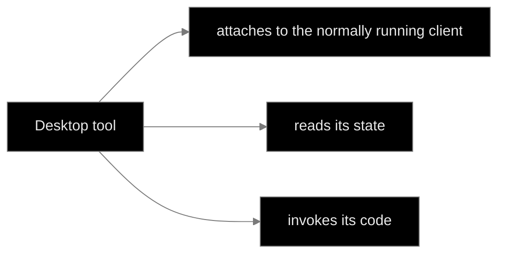

[RoK Toolkit](../../README.md) › [Docs](../README.md) › The Lua Runtime Method

# The Lua Runtime Method

Unlike [headless](../headless/README.md), a desktop tool attaches to the normally running client, reads its state, and invokes its code.

| Layer | Page |
| --- | --- |
| Attachment | [Attach and the Execution Hook](01-attach.md): process discovery, elevation, attachment, single-thread rule |
| Reading | [Reading the Client](02-client-reads.md): read constraints, catalogue, raw table reads, install files |
| Acting | [Invoking the Client](03-client-calls.md): client functions, server view, message wrapping |
| Session | [Governors and Reloads](04-governors.md): in-client switching, reload hold |

## Boundary

Measured boundary: the tool does not log in, speak the protocol, or present client identity. It uses the running client’s process, code, and session.

---

[← The RoK-Data Store](../headless/game-systems/07-rokdata-store.md) &nbsp;·&nbsp; [↑ Documentation Map](../README.md) &nbsp;·&nbsp; [Attach and the Execution Hook →](01-attach.md)

